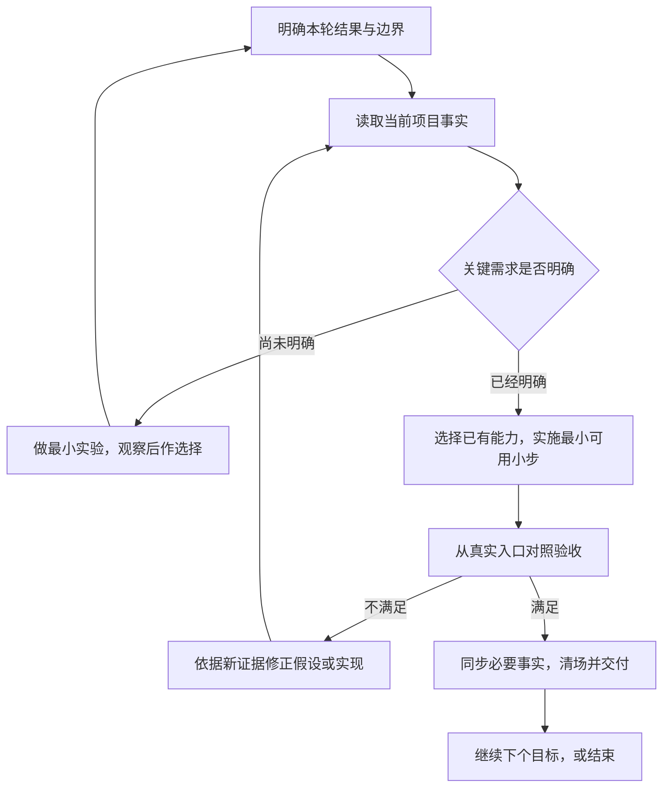

# Nova 项目 AI 研发方法论

**用最少的必要上下文和步骤，持续交付经过验收的项目变化。** 需求清楚时尽快实现；需求不清时先用小实验减少不确定性；改动影响大时检查完整契约和消费链。衡量效率时同时看交付时间、人工审查与返工、质量和工具成本。

本方法是 Nova 协作体系面向项目研发的方法手册。[日常研发的最小原则](DEVELOPMENT_CONSTRAINTS.md#日常研发的最小原则)是框架开发与消费端共用的短底线，由[共同入口](../START_HERE.md#日常研发的共同入口)路由；本手册解释需要时如何深入处理，不以某个 Skill 被选中作为这些原则的前提。

具体操作继续复用当前安装版本的 Skill 和工具。[nova-project-development](../../Agents/Skills/nova-project-development/SKILL.md)只在需要比较方案、梳理复杂变化或安排多个依赖阶段时提供轻量引导，不承担整套方法，也不新增操作权限。

本文是可以试用和修正的方法，不宣称已经证明对所有项目最优。原材料的适用范围、研究依据与未证实主张见[来源分析](../../Agents/Skills/nova-project-development/references/source-analysis.md)。

## 按需阅读导航

| 当前需要 | 读取内容 |
|---|---|
| 普通单点修改或明确操作 | [共同原则](DEVELOPMENT_CONSTRAINTS.md#日常研发的最小原则)与所选 Operation；无需展开本手册 |
| 玩法、交互或目标未定 | [选择研发路径](#选择研发路径)，再看[开发闭环](#每轮开发的闭环)中的任务约定与实验分支 |
| 已明确但涉及多个依赖阶段的功能 | [开发闭环](#每轮开发的闭环)中本轮相关的实施与验收分支 |
| 中途改需求或交接恢复 | [需求变化与中断](#需求变化与中断) |
| 控制阅读成本、评估常驻或多人并行 | [上下文与常驻策略](#上下文与常驻策略)、[并行协作的条件](#并行协作的条件)中的命中部分 |
| 评估方法是否省时 | [效果评估](#如何检验这套方法是否省时)；仅审查依据时再读来源分析 |

## 选择研发路径

先分别回答两个问题：**现在最不确定的是什么？改错后会影响谁、恢复多难？** 不确定性决定先学习还是先实现；影响面决定检查和验证的深度，两者不能混成一个复杂度分数。

| 当前任务 | 首先解决什么 | 本轮应得到的结果 |
|---|---|---|
| 明确的文案、常量或局部小修 | 确认准确目标和当前实现 | 最小修改与对应局部检查；不套完整流程 |
| 玩法、交互或产品方向未定 | 找出会改变决策的关键假设 | 可撤回的小实验、观察结果和下一步判断 |
| 规则明确的功能 | 找到真实入口与最短依赖链 | 一个能从入口使用、能独立验收的纵向小步 |
| 缺陷 | 分清现象、复现条件和直接原因 | 有依据的修复，以及能覆盖该故障的必要验证 |
| 接口、序列化、配置、存档或生命周期变化 | 检查受影响的调用方和兼容性 | 合同一致、来源到消费者接通的变更 |
| 评审或排障分析 | 核实当前事实和证据缺口 | 定位、风险和建议；只读目标保持只读 |

这些是选路条件，可以组合。例如玩法方向未定且涉及旧存档时，先在不迁移真实数据的范围验证玩法假设；不能把探索当作忽略数据兼容的理由。Nova 风险与最低证据遵守 [NA-013：验证真实接线，并按风险区分证据层级](DEVELOPMENT_CONSTRAINTS.md#na-013验证真实接线并按风险区分证据层级)。

## 每轮开发的闭环

这个闭环描述判断顺序，不要求每次生成文档、经过所有工具或等待人工批准。单点小改直接完成对应的最短路径。

### 1. 用最小任务约定对齐结果

从用户描述、已有决策和项目事实中提取：希望发生的变化、本次范围、要保留的行为、怎样判定完成、尚未知什么。约定通常只需几句话，保留在对话或现有任务中即可。[任务模板](../../Agents/Skills/nova-project-development/references/task-templates.md)只用于补缺，不是用户必填表。

Agent 自行查明技术名词、文件、配置现值和已有用法。玩法选择、真实素材、业务协议或外部账号无法从代码推导时，提出最少的问题，同时继续独立工作。临时参数要有明确用途和替换位置，不能把猜测、示例值或格式合法当成业务事实。

人负责产品取舍、主观体验和最终接受；Agent 可以参与方案比较、提出反例、实现、测试与排障。AI 对玩法的意见作为待验证假设，最终用试玩、用户反馈或产品目标判断。

### 2. 获取足够的当前事实

先沿[当前框架入口](../START_HERE.md)和模块文档定位，再读涉及行为的最小源码、配置与调用方。相同工程已确认且未变化的事实可以复用；信息冲突、路径漂移或关键行为未知时再深入。

| 信息 | 应从哪里确认 | 如何使用 |
|---|---|---|
| 用户想要的结果 | 当前需求与已确认决策 | 作为目标，不冒充已经实现 |
| 当前代码与接口 | 实际安装版本、源码和相邻 XML | 确认可用入口与局部语义 |
| 当前参数与绑定 | 权威源、真实配置资产和实际对象 | 区分声明默认值与有效值 |
| 运行行为 | 对应版本、场景、平台的本次观察 | 只证明实际覆盖范围 |
| 历史理由 | 项目已有决策记录 | 提供线索，关键事实仍核当前来源 |

每类信息各有一个正文所有者，不把设计、代码、配置和运行证据挤进一份万能记忆文件。示例用于学习已有风格和接线，不授予绕过当前合同的许可；优先读最相关的现行示例，不规定必须读几个。

### 3. 未知先实验，明确后实现

探索任务先说明：要验证的假设、最小实验、观察信号、投入边界、结束后如何取舍。可用灰盒、交互草图、有限实现或受控试玩获得信息；避免一开始搭建完整架构和完整内容。实验也遵守当前项目基线，不绕过 Nova 初始化、必要配置或正式工具。

产品验证问的是“玩家是否理解、是否愿意继续、这种交互是否达到目标”；工程验证问的是“实现是否满足规则、能否正确失败和退出”。测试通过只回答后者。样本少的试玩只能提供方向，不能包装成统计结论。

需求明确后，把任务拆成能从真实入口使用的小步。例如“设置页打开、调整音量并立即生效”是一个小步；仅完成表结构、再完成全部 Service、最后才接 UI，会推迟暴露接线问题。已有启动环境和必要工程基线仍须先满足，不用纵向拆分省略前置。

视觉、输入手感和目标平台若影响核心判断，就尽早验证；不把全部适配、性能、生命周期问题固定留到最后。数值按项目已有权威配置和导出链管理，不普遍引入覆盖系统，也不默认把调好的配置烘焙回源码。

### 4. 复用 Nova 能力并持续执行

先用[能力导航](NATURAL_LANGUAGE_DEVELOPMENT.md)寻找现有领域能力；领域不清才用[项目任务路由](../../Agents/Skills/nova-project-router/SKILL.md)。已知的单项任务直接进入 Operation，已有领域 Workflow 优先复用。复杂需求经[梳理入口](../../Agents/Skills/nova-project-development/SKILL.md)明确下一步后，继续推进用户已授权工作；不要求所有任务先经过它，也不只交一份计划便停止。

每次即将执行某个分支时，读取其当前合同、参数来源及必要引用，保留写集、锁、确认、幂等、恢复和最低证据。新建、首次配置和实验也适用。固定操作复用已有 Action、CLI 或 Pipify；开放式业务逻辑在项目自有源码中实现。不能用临时一键脚本重做已封装的资产、配置或导出操作。

涉及多个领域时，按实际依赖安排，而不预先执行全部能力。例如数据驱动页面优先使用[已有 Workflow](../../Agents/Skills/nova-project-data-driven-ui/SKILL.md)；单次导表使用[导表 Operation](../../Agents/Skills/nova-project-export-tables/SKILL.md)。新项目仍先满足[开工准备](PROJECT_STRUCTURE.md#新项目开工准备)，成熟项目的局部任务只复核本次依赖，不重复整套初始化。

### 5. 用与目标相称的证据验收

实施前就明确验收信号，避免完成后反过来选择容易通过的检查。复杂任务覆盖主要成功路径，以及本次改动相关的失败、重复、取消、重开或退出条件；低影响改动不制造镜像实现的测试。

| 要声称什么 | 需要的对应证据 |
|---|---|
| 文案、链接或局部说明正确 | 精确差异、目标路径或解析检查 |
| 代码能编译 | 当前目标下真实编译结果 |
| 一项业务可用 | 从已保存的真实入口触发并观察结果 |
| 配置或表已生效 | 权威源、正式导出与实际消费者一致 |
| 存档可恢复 | 通过独立读取路径或重新启动读取；缓存写后读不足以证明 |
| 目标平台可交付 | 相应构建报告、正式产物及本次所需的目标运行证据 |
| 外部接入成功 | 对应服务、设备或后台的实际结果；本地 Mock 不替代 |

日志对比本轮新增或变化的问题；既有无关警告保留归属与影响，不为“清零”扩大改动或关闭日志。截图只证明可见状态；审查者的判断不能替代编译、运行或外部结果。独立审查用于重大兼容、复杂并发或确有盲点的变更，普通小改不自动增加 reviewer。

失败时先确认最早失败阶段和已取得的证据，再决定修改输入、实现或工具路径。没有新增证据时不原样反复重试；执行结果未知的有副作用操作先核原计划、回执和恢复状态。

### 6. 更新必要事实并清场

需求或实现事实变化时，更新其已有正文；接口事实仍在源码/XML，跨方法流程在模块 Docs，项目决策保留理由和适用条件。会话当前进度用短交接恢复，不默认写成永久知识。可复用缺陷记录根因、触发条件和防线，不记录每次调试过程。

按 [NA-014：授权范围、实时合同和恢复回执约束实际执行](DEVELOPMENT_CONSTRAINTS.md#na-014授权范围实时合同和恢复回执约束实际执行) 清理本轮临时材料、恢复测试态并核对工作区及辅助窗口。保留用户已有改动、正式交付和未完成事务的恢复必需材料。交付说明实际变化、证据覆盖、缺项与清场结果；未达到目标或存在无法安全清理的本轮残留时，准确报告部分完成或阻塞。

## 需求变化与中断

需求改变时，先确认新目标，找出失效的验收、依赖和未完成步骤；保留仍有效的实现与事实。只调整受影响的部分，不为维护旧路线图继续过时工作，也不默认推倒重写。公开接口、配置或存档受影响时，再进入相应兼容检查。

需要交接或上下文已混乱时，保留：目标、已确认约束、准确项目与文件位置、已做及已验范围、未解决问题、下一步、正在执行的任务或恢复标记。恢复后先核对变化过的来源。对话是否换新由状态可恢复性决定，不按固定轮数决定。

用户收窄或停止时，立即停止超出新范围的动作；按新范围处理本轮过程材料，不换工具继续被停止的工作。

## 上下文与常驻策略

方法论采用“共同原则、按需手册、任务操作”的分工，随 Nova 同版本维护。分发文件、宿主发现、Agent 实际读取和宿主常驻加载分别核实。

| 层级 | 放什么 | 何时加载 |
|---|---|---|
| [共同原则](DEVELOPMENT_CONSTRAINTS.md#日常研发的最小原则) | 最少的日常判断与原有规则路由 | 进入任意 Nova 任务时；同会话已读且未变化可复用 |
| [共同入口](../START_HERE.md#日常研发的共同入口) | 原则入口与当前任务的阅读路径 | 所有匹配的 Nova Project Skill 先读 |
| 本方法与模板 | 当前分支的详细做法 | 按阅读导航展开相关章节 |
| 具体任务 Skill | 该任务的输入、操作、授权、恢复与验收 | 真正执行该操作前 |
| [复杂需求梳理 Skill](../../Agents/Skills/nova-project-development/SKILL.md) | 比较方案、梳理变化和阶段依赖 | 只有这些问题确需集中梳理时 |
| 来源分析 | 来源差异、研究边界与方法取舍 | 审核方法或评估成本时 |
| 项目事实 | 当前相关源码、配置、资产和短交接 | 定位后精读，变化时复核 |

消费端当前读取链为：从受管投影发现任意匹配的 Nova Skill，定位当前实际解析包并读取其 Skill 真源，再按首段共同底线进入 START_HERE 和相关原则。投影是原样副本；跨到 Docs 的相对链接从包内真源解析，不能从项目投影目录猜项目根 Docs。该链不依赖 `nova-project-development` 被选中。

当前同步器不创建或修改消费项目根 `AGENTS.md`，也不向宿主强制注入全文。因此“日常默认遵循”描述的是进入 Nova 任务后的共同执行要求，不表示 Agent 尚未读取任何 Nova 入口时也已常驻加载；分发、首段检查和文件哈希不能证明 Agent 实际读过。消费端验收要分别检查投影、准确包根和真实阅读行为。

全文与研究材料继续按需读取。将来若需要宿主开场即获得少量提示，应先核对该项目实际使用的规则入口、已有内容与部署授权，保留原规则并验证真实加载；不因本方法已随包分发就自动修改根规则或复制整篇内容。评估时同时看遗漏、阅读与执行成本、重复和小改误触发情况。

## 并行协作的条件

先识别关键路径。能独立完成的资料核查、不同验证、写集不重叠的实现可并行；当前下一步所依赖的关键实现通常由主线处理。分工写清目标、输入、允许范围和可核验交付物，整合者对最终结果负责。

共享 Unity Editor、AssetDatabase、活动场景、表配置和同一输出目录保持原合同的单写者规则。模型和 reasoning effort 服从当前用户与项目约定，本方法不另设型号或自动切换主 agent。分派、等待和整合成本大于可节省工作时就顺序执行。

## 如何检验这套方法是否省时

先在已有任务记录或当次对话中抽取少量有代表性的日常任务，按小改、探索、明确功能和契约变化分别观察。试用阶段不要用少量样本宣布显著提效，也不为测量新增永久验收档案。

同时记录或估计三类成本：

- 从需求到通过验收的实际历时，包括等待、验证和返工；并行任务按实际历时统计，不重复相加。
- 人的需求澄清、审查、试玩和返工投入；避免只测 AI 生成时间。
- 可取得的模型、工具与运行费用；费用不明时标未知，不以 token 数直接代替钱。

质量至少观察首次验收是否通过、是否出现相关回归、是否留下未验证范围和维护负担。任务大小、熟悉程度、工具版本和外部等待都会影响比较；比较相近任务，明确这些差异，必要时交替试用不同做法。没有质量底线的速度指标、代码行数和文件数量都不足以证明效率。

每次只修正有证据的问题：上下文不够补准确入口，读得过多收紧加载分支，验收遗漏补观察信号，协调过重减少并行，重复机械操作复用确定性工具。稳定有效后再考虑把少量提示上收为共同入口。
