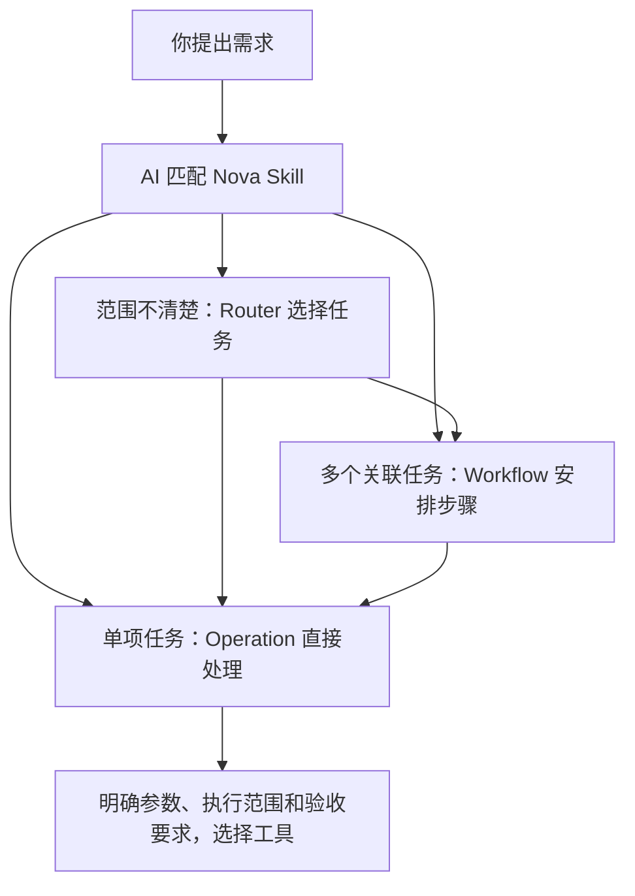
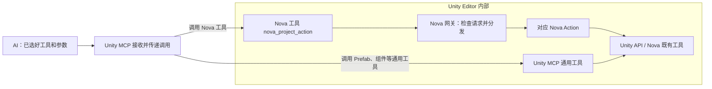

# 用人话理解 Skill、Action 与 MCP

**Skill 告诉 AI 怎么完成任务，Action 执行已经封装好的具体动作，MCP 把工具调用送进 Unity。Router、Workflow、Operation 是三种不同职责的 Skill。**

理解它们时，要分别看“任务怎么安排”和“请求怎么送达”。前者由 AI 按 Skill 的说明处理，后者由 MCP 通道和工具接收。

## 六个概念分别是什么

| 概念 | 人话解释 | Nova 中的例子 |
|---|---|---|
| Skill | 一份任务说明书，写清需要什么信息、怎么做、做到什么程度才算完成 | 导出表、接入 SDK、诊断启动失败 |
| Router | 接待人员，听懂需求后选择合适的任务说明书 | 范围不清楚时，判断该进入配置、资源、构建还是诊断 |
| Workflow | 施工安排，把几个有依赖的任务组织起来 | 接入 SDK 时安排安装包、配置、平台检查与运行验证 |
| Operation | 一项可以单独验收的任务 | 导出表、构建 Player、更新一个页面 |
| Action | 已经写好的执行动作，接收明确参数、检查条件、执行并返回结果 | 导出 Table、导出运行时配置、构建 Player |
| MCP | AI 调用外部工具的通信协议；当前 Unity MCP 提供连接 Unity 的通道和通用工具 | 把 AI 的工具请求交给 Unity Editor 中的处理函数 |

这里的 Operation 指 Operation Skill。MCP 请求里的 `operation=describe / plan / execute / verify` 指同一个工具的调用阶段，两者含义不同。

## 第一件事：决定任务怎么做

Skill 是 AI 读取的说明，不会自己运行 C#。AI 按说明理解目标、检查项目事实、明确输入和验收要求，再选择要调用的工具。

这不是必须逐层经过的固定流程。“导出表”已经很明确，可以直接进入 Operation；只有任务包含多个依赖步骤时，才需要 Workflow。

一个 Workflow 可以组织多个 Operation，一个 Operation 可以调用多个 Action，同一个 Action 也可以被多个 Skill 复用。只读分析或工作区文件任务可能只使用读取、编辑或 CLI 工具，不经过 Unity MCP。

“这个参数是什么意思”“哪里有对应功能”可以先用随包 `Agents/Tools/nova_capabilities.py` 的 `inventory` / `describe` 查询功能、源码参数声明、文档和现有工具入口，Router 再按结果选择任务。它展示的源码默认值不等于当前项目有效值，查询也不执行配置修改。

Nova 按功能族维护这份映射，让一个 Skill、Action 或固定代码入口服务多个参数和任务。日常开发把参数与局部行为说明放在源码/XML，把跨方法流程放在已有 Docs，再同步能力导航、执行契约与验收要求；已有接口能完成的固定操作直接复用，新增顶层 Skill 需要新的独立用户任务和验收边界。

## 参数和函数如何找到工具

例如你说“调整请求超时”，Agent 先查对应字段或方法，再读旁边的 XML 注释和所属模块 Docs，理解单位、默认值、何时生效；随后读取当前对象或配置，确认项目实际值。功能导航再把它引到已有配置 Skill，由该 Skill 选择已开放的 Action 或 Unity 编辑工具。

这里没有“每个函数必须绑定一个工具”的要求。多个字段和函数可以服务同一个任务，内部 helper 也无需直接暴露。工具参数始终从当前 live `describe` 获取，函数声明不是执行授权。

索引由源码自动生成，用文件、类型、方法签名区分身份和重载。位置与指纹只是帮助工具找到并核实当前源码，不要求人工维护代码行号；源码变动导致位置过期时刷新索引，不靠旧行号接着读。注释只维护在代码里，Docs 说明流程；不再复制一套函数说明或历史验收档案。

## 第二件事：把选好的调用送进 Unity

AI 在 Unity Editor 外部，Nova Action 在 Unity Editor 内部，需要连接把请求送进去。**Nova 当前复用 Unity MCP 的连接，并把自己的 `nova_project_action` 工具注册进去。**

AI 在发出请求之前，就已经选择了 Nova 工具。“先经过 Unity MCP”说的是请求经过的通道；需求分析已经在上一阶段完成。

执行结果沿调用通道返回，AI 再按 Skill 的要求核对是否完成任务。

**Nova Action 已经在 Unity Editor 内部，可以直接调用 Unity API 和 Nova 既有工具。它不需要再发一次 MCP 请求来执行这些内部调用。**

## 已经有 Unity MCP，为什么还需要 Nova MCP 包

Unity MCP 提供通用操作，例如修改组件、操作 Prefab、读取 Console。这些能力让 AI 能操作 Unity；Nova 专项功能还需要明确 Nova 自己的配置、导出和构建规则。

以“导出运行时配置”为例，助手需要知道当前配置、平台/渠道/模式、输出位置和成功标准。Nova Action 把确定性的检查与执行封装好，Skill 负责理解本次需求和验收，减少每次重新推导调用链产生的遗漏。

当前 `com.solotopia.nova.framework.mcp` 是连接适配包：它包含中立网关和默认 Unity MCP 工具适配器，复用 Unity MCP 服务。配置、导出、HybridCLR 和构建的领域实现仍由 Framework 中的 `EditorUtil.AgentActions` 包装既有工具完成。

可以把它理解成：**Nova 给 Unity MCP 装了一个专用扩展。**包名包含 MCP，不代表它另外启动了一套独立 MCP 服务。

## “注册工具”是什么意思

注册就是告诉 Unity MCP：

> 我这里有一个工具，叫 `nova_project_action`。它接受这些参数；收到调用时，请交给这个 C# 处理函数。

注册后，AI 才能发现这个工具，Unity MCP 也才知道把请求交给谁。当前 `NovaProjectActionUnityMcpTool` 使用 `McpForUnityTool` 和 `AutoRegister=true` 声明工具，`HandleCommand` 把请求交给 `NovaProjectActionGateway`。

`nova_project_action` 是对外工具入口；`nova.project.table.export` 等是入口内部选择的 Action ID。Skill、MCP Tool 和 Action 是三张不同的清单，数量没有一一对应关系。Skill 从项目 `.agents/skills/` 发现；Action 的实际可用列表与参数以工具的 `describe` 返回为准。

## 技术上必须经过 Unity MCP 吗

技术上可以使用其他连接方案；**当前默认 Unity MCP 适配器通过 Unity MCP 调用，这是当前实现的选择。**

Nova 的中立契约与 Action 内核和第三方 Provider 分开。如果另做独立 Nova MCP 服务，就需要另外实现和维护服务启动、连接 Unity、工具发现、请求传递和断线处理。复用已有连接可以减少这部分重复建设；更换连接方案也不意味着重新实现所有 Action。

安装 Nova MCP 包只完成包和工具适配器的安装。外部 AI 宿主仍需连接 MCP 服务；包不会替宿主启动服务、占用端口或自动刷新已有会话的工具列表。

## 用两个任务串起来

### “帮我导出表”

1. AI 读取 `nova-project-export-tables`，直接进入 Operation。
2. 明确导出范围，通过 `nova_project_action` 选择 `nova.project.table.export`。
3. 按 `describe → plan → execute → verify` 执行：先了解参数，再检查和冻结计划，在本次授权范围内执行，最后核对结果。
4. Action 实际导出；Skill 要求包含代码导出时还检查编译。这里验收的是导出结果。

工具的 Plan 会展示实际输出范围，执行仍遵守 Skill 与 Action 的确认要求。`confirmation_token` 绑定一次性计划，用户授权由调用方按本次任务落实。

### “把这个 SDK 接进项目并跑起来”

AI 读取 `nova-project-onboard-sdk-kit` 这个 Workflow，组织包安装、配置、平台检查和最小运行验证。其中安装包和配置由对应 Operation 处理，再调用需要的 Action；运行验证按项目和包文档完成。

**Action 成功只证明它自己的操作完成。**“配置导出成功”不能直接当成“SDK 接入并运行成功”，后者还需要满足整个 Workflow 的验收要求。

已有固定入口应直接复用：`nova.project.ui.export` 支持全部 Unit 的 all/code/data，以及指定 Excel 的 code/data；单文件 all 没有原子领域入口。ConfigMaster 面板检查、补引用、批量字段修改与归一化使用对应配置 Action；符合资产契约的自有普通 Prefab 组件或单对象 SO，使用 `nova.project.settings.inspect-target / patch-target` 检查并保存真实字段。场景、内置组件、Prefab 变体/嵌套和 UnityEvent 仍按同一配置 Skill 的共享 Unity MCP 分支处理，其冻结、收据和脱敏保证与 Nova Action 分开核实。Player Action 当前只支持 Standalone 桌面与 WebGL，Android/iOS 由已有平台专属分支交付。实际参数与开放范围以 live `describe` 为准；导出、字段保存或构建成功分别按对应任务验收。

## 继续阅读与实现依据

- [Nova Project Skills](../../Agents/INDEX.md)：当前消费端能力清单、分发位置和执行契约。
- [自然语言开发入口](NATURAL_LANGUAGE_DEVELOPMENT.md)：查询当前函数、参数与输入知识，并按本次任务验收。
- [Agent 快速入口](../START_HERE.md)：自动发现、项目边界和日常任务入口。
- [EditorUtil.AgentActions](../Editor/EditorUtil/EditorUtil.AgentActions/EditorUtil.AgentActions.md)：Action 的计划、执行、验证与恢复协议。
- [Framework 到中立契约的适配实现](../../Scripts/Editor/EditorUtil/EditorUtil.AgentActions/NovaProjectActionContractProvider.cs)：把请求转交 `EditorUtil.AgentActions`。
- Nova MCP 包内 `Nova/Docs/INDEX.md` 和 `Nova/UnityMcp/Editor/NovaProjectActionUnityMcpTool.cs`：当前工具注册、连接与分发实现。消费项目从已安装的 `com.solotopia.nova.framework.mcp` 包查看；开发仓对应 `UPMPackages/com.solotopia.nova.framework.mcp/`。
