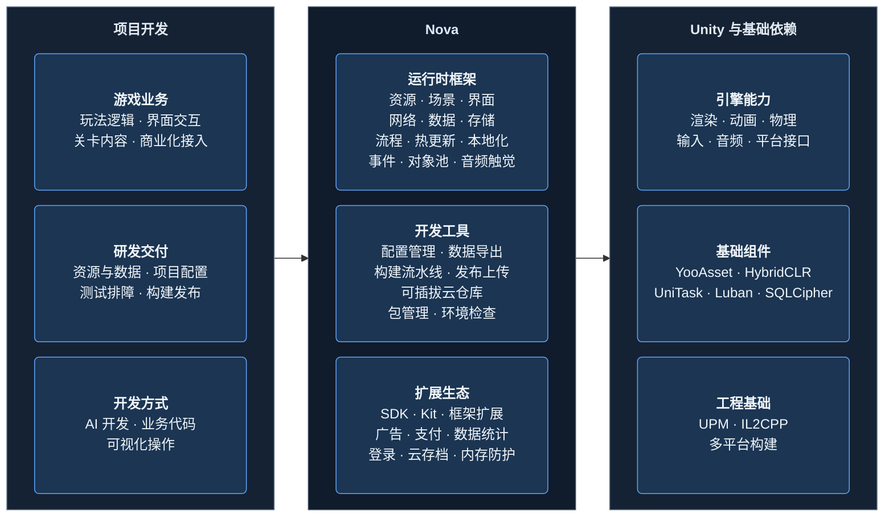

# Nova

**Nova 是 Solotopia 面向 Unity 游戏开发的客户端框架。**

集成资源管理、界面、网络、热更新与数据存储，配套配置、构建、包管理工具与 AI 开发能力，覆盖从项目接入到构建发布的日常工作。

[核心能力](#核心能力) · [安装](#安装) · [快速开始](#快速开始) · [文档与示例](#文档与示例)

## 系统需求

- Unity `6000.4.x`，最低版本为 `6000.4.2f1`。
- Built-in Render Pipeline、IL2CPP、.NET Standard 2.1、C# 9。
- 可访问 Solotopia UPM Registry：[https://upm.solotopiax.com](https://upm.solotopiax.com)，以及 [OpenUPM](https://package.openupm.com)。
- Android / iOS 构建需配置对应的平台模块、SDK 与签名环境。

## 核心依赖

下表列出当前源码工程使用的主要包版本，完整依赖声明见 [Framework 包清单](Assets/Framework/package.json)。

<table>
<tr>
<td valign="top" width="50%">
<table>
<tr><th align="left" width="300">包名</th><th width="60">版本</th></tr>
<tr><td><code>com.solotopia.hybridclr</code></td><td>10.1.2</td></tr>
<tr><td><code>com.solotopia.yooasset</code></td><td>1.2.2</td></tr>
<tr><td><code>com.solotopia.unitask</code></td><td>10.0.7</td></tr>
<tr><td><code>com.unity.inputsystem</code></td><td>1.20.1</td></tr>
<tr><td><code>com.unity.textmeshpro</code></td><td>5.0.0</td></tr>
</table>
</td>
<td valign="top" width="50%">
<table>
<tr><th align="left" width="300">包名</th><th width="60">版本</th></tr>
<tr><td><code>com.solotopia.luban</code></td><td>10.1.1</td></tr>
<tr><td><code>com.solotopia.sqlcipher4unity3d</code></td><td>10.0.6</td></tr>
<tr><td><code>com.unity.nuget.newtonsoft-json</code></td><td>3.2.2</td></tr>
<tr><td><code>com.unity.scriptablebuildpipeline</code></td><td>4.0.1</td></tr>
<tr><td><code>com.solotopia.nova.framework.mcp</code></td><td>0.1.9</td></tr>
</table>
</td>
</tr>
</table>

## 架构概览

Nova 提供运行时框架、开发工具与扩展生态，支持 AI 开发、代码接入和可视化操作。

## 核心能力

| 能力 | 用途 |
|---|---|
| 启动与热更新 | 启动流程编排、版本检查、资源更新与业务代码加载。 |
| 资源与场景 | 同步 / 异步加载、下载与缓存、场景加载及 Prefab 实例管理。 |
| 界面与本地化 | 界面生命周期、分组与层级管理，多语言切换与字体适配。 |
| 数据与配置 | 强类型数据表、本地与远端应用配置，以及 SDK、Kit 配置访问。 |
| 本地存储 | PlayerPrefs、分片文件与加密 SQLite 存储。 |
| 网络通信 | HTTP、WebSocket 与业务请求的主备域名切换。 |
| 音频与触觉 | 音乐、音效、声音组控制与移动端振动反馈。 |
| 应用与系统 | Android 安装包下载、通知权限、系统设置跳转与应用内评价请求。 |
| 基础设施 | 事件、状态机、对象池、引用池、日志与运行时调试。 |
| SDK 与 Kit | 按需接入广告、登录、支付、统计等 SDK，以及独立功能套件。 |

配套开发工具：

| 工具 | 用途 |
|---|---|
| Config | 按平台、渠道与开发模式管理配置，导出运行时配置。 |
| 数据导出 | 将表格转换为运行时数据与访问代码，覆盖业务表、界面、网络、本地化、音频和振动配置。 |
| Pipify | 可视化编排数据导出、热更新准备、资源构建、Player 构建与发布上传。 |
| PlugPals | 可插拔云仓库与插件管理，支持包发现、安装、升级与卸载。 |
| AI 开发 | 通过自然语言完成项目接入、业务与界面开发、配置、构建和排障。 |

## 安装

1. 下载 [NovaSpark.cs](NovaSpark.cs)，放入项目的 `Assets/Editor/`。
2. Unity 编译完成后，在弹窗中点击 **引入框架**。
3. 等待依赖包与 AI 开发工具自动配置完成。

安装与工具链说明见 [安装指南](Assets/Framework/Docs/Editor/EditorUtil/EditorUtil.AgentSkills/EditorUtil.AgentSkills.md)。

## 快速开始

1. 在 Unity Package Manager 中选择 **Nova Framework**，导入 **MainDemo**。
2. 按导入提示设置启动场景，进入 Play Mode。
3. 参照 [演示索引](Assets/Samples/MainDemo/DEMO-INDEX.md) 体验各模块，并查看对应示例代码。

接入自己的项目时，从 [接入指南](Assets/Framework/Docs/START_HERE.md) 开始。

## 文档与示例

| 入口 | 内容 |
|---|---|
| [接入指南](Assets/Framework/Docs/START_HERE.md) | 项目接入与开发起步。 |
| [使用手册](Assets/Framework/Docs/INDEX.md) | 运行时 API、编辑器工具与模块示例。 |
| [架构说明](Assets/Framework/Docs/ARCHITECTURE.md) | 模块划分与职责边界。 |
| [MainDemo](Assets/Samples/MainDemo/README.md) | 安装、运行与示例说明。 |
| [AI 开发指南](Assets/Framework/Docs/Onboarding/NATURAL_LANGUAGE_DEVELOPMENT.md) | 自然语言开发与常用任务入口。 |
| [更新日志](CHANGELOG.md) | 版本变化与升级说明。 |

## 参与贡献

提交问题或贡献代码，请参阅 [贡献指南](CONTRIBUTING.md) 与 [行为准则](CODE_OF_CONDUCT.md)。安全问题请通过 [安全报告渠道](SECURITY.md) 反馈。

## 许可证

本项目基于 [MIT License](LICENSE) 开源。

Copyright © 2026 Solotopia
